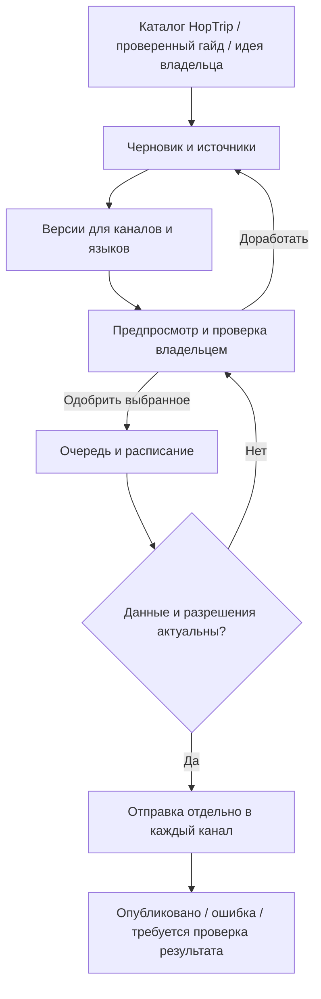

# HopTrip: план редакции и публикаций в социальных сетях

Дата плана: 2026-10-21. Обновлено: 2026-10-24. Планирование: **done**.
SOC-02 реализован и проверен локально; серверное включение и подключения соцсетей: **pending**.
Создание аккаунтов, покупка сервисов и публикация постов этим документом не выполняются.

## 1. Результат, который строим

HopTrip предлагает тему или актуальное предложение → готовит материал → адаптирует
его под площадки → владелец видит конечные версии → выбирает аккаунты, язык и время →
одобряет → система проверяет актуальность и публикует → показывает результат по каждому каналу.

Одобрить можно все выбранные версии одним действием либо каждую отдельно.
Новая версия текста, изображения, цены, ссылки или новый аккаунт назначения требует
нового одобрения. Изменение времени также фиксируется владельцем; автоматические
повторы разрешены только в пределах согласованного срока актуальности.

## 2. Что уже есть и что потребуется

По словам владельца, маркетинговых аккаунтов пока нет. Это исходная точка плана,
а не результат проверки личных кабинетов.

В репозитории подтверждены:

- Next.js frontend, Python API и PostgreSQL; редакционные статьи и каталог предложений.
- Отдельный планировщик загрузки данных: `apps/api/app/jobs/scheduler.py`.
- Защищённый административный API с `X-Admin-Token`: `apps/api/app/api/admin.py`.
- Технические Telegram-уведомления: [telegram-notifications.md](telegram-notifications.md),
  `scripts/setup-notifications.py`. Они предназначены для отчётов и мониторинга.
- Ограниченный набор campaign в `apps/api/app/api/analytics.py`: произвольные новые
  UTM-метки ещё не означают, что текущая аналитика их сохранит.

Маркетинговый модуль создаём отдельно от технических отчётов: новый бот, получатели,
секреты, очередь и переключатель публикации. Не менять `TELEGRAM_CHAT_ID` мониторинга
и не запускать существующий setup уведомлений для подключения маркетинга.
Переиспользуем данные и инфраструктуру приложения, но сбой соцсети не должен блокировать
обновление каталога. Код автопубликации и редакционная админка пока не реализованы.

## 3. Решения по умолчанию

Это предлагаемые настройки, которые владелец сможет изменить до запуска.

| Вопрос | Предложение |
| --- | --- |
| Первая аудитория | Польскоязычные путешественники с вылетами из Польши |
| Язык публичных каналов | PL; RU для внутренней редакции |
| Другие языки | EN/RU/UK как отдельные версии, после определения аудитории и проверки опубликованных страниц сайта |
| Первый канал | Telegram, затем Facebook и Instagram |
| TikTok | Аккаунт резервируем сразу; публикацию подключаем после выбора допустимой интеграции |
| LinkedIn | Страница проекта; материалы о продукте, данных и партнёрствах |
| Кто принимает решение | Владелец; никакого автоматического одобрения по тайм-ауту |
| Часовой пояс расписания | Europe/Warsaw; в базе UTC, с обработкой переходов летнего времени |
| Публичные тесты | Только после отдельного согласования конкретного поста и места публикации |

Наличие переводов в Git-ветке не доказывает доступность этих URL на production.
Перед публикацией проверяем реальную целевую страницу и язык.

## 4. Подготовка владельца: один раз для всех площадок

1. Выбрать рабочий email, к которому есть постоянный доступ. Если нужен адрес на
   `hoptrip.pl`, сначала создать ящик или работающую переадресацию и проверить получение письма.
   Адрес вида `social@hoptrip.pl` — лишь вариант, существование такого ящика не подтверждено.
2. Подготовить телефон для подтверждения регистрации. Для личных профилей управляющего
   использовать реальные данные владельца. Для бренда создавать страницу/бизнес-аккаунт.
3. Выбрать общий ник: сначала проверить `hoptrip`, затем `hoptrippl`, `hoptrip_pl`.
   Доступность не проверена; точки и подчёркивания допускаются не везде.
4. Подготовить логотип, квадратный аватар и короткое описание проекта. Использовать
   существующее оформление сайта; точные размеры обложек проверить в интерфейсе площадки.
5. Сохранить пароли в менеджере паролей, включить двухфакторную защиту и сохранить
   резервные коды. Пароли, токены, SMS-коды и резервные коды не отправлять в переписку и Git.
6. Определить публичный контакт. Не показывать личный телефон/домашний адрес в профиле,
   если они не должны быть публичными. Обязательные данные вводить достоверно.
7. Заполнить реестр в разделе 11: достаточно публичных ссылок и статуса настройки.

Черновик польского описания, который можно адаптировать под ограничения поля:

> Loty z Polski, pomysły na wyjazdy i praktyczne poradniki. Sprawdź daty, cenę i warunki na hoptrip.pl.

Для первого закреплённого поста подготовим объяснение: HopTrip помогает находить
предложения, цена является наблюдением, условия подтверждаются у продавца.
Фразу «самые дешёвые билеты» без достаточного основания не используем.

## 5. Создание аккаунтов: действия владельца

Названия пунктов меню зависят от языка и версии приложения. Ниже — маршрут настройки;
если пункт отсутствует, зафиксировать текст ограничения, а не покупать обходной аккаунт.

### 5.1. Telegram: публичный канал и отдельный бот

**Создать:** публичный канал HopTrip, закрытый тестовый канал и нового маркетингового бота.
Для начала одобрение будет в защищённой веб-редакции; уведомление о черновике можно
присылать владельцу в личный диалог с этим ботом.

1. В своём Telegram открыть создание сообщения → «Создать канал».
2. Указать название `HopTrip | Loty z Polski`, описание и аватар.
3. Выбрать публичный канал; подобрать доступное имя и сохранить ссылку `t.me/...`.
4. Отдельно создать **приватный** канал `HopTrip — Social Test`. Не публиковать его приглашение.
5. Открыть официального [@BotFather](https://t.me/BotFather), выполнить `/newbot`.
   Указать отображаемое имя `HopTrip Publisher` и свободный username с окончанием `bot`.
6. Полученный токен сохранить в менеджере секретов. При подключении разработчик
   подготовит отдельный безопасный ввод на сервере; сейчас токен никому не пересылать.
7. Добавить нового бота администратором тестового канала, дать право публикации.
   Право редактирования добавить, если согласован сценарий исправления постов;
   управление другими администраторами боту не требуется.
8. Открыть личный диалог с ботом и нажать Start, если нужны личные редакционные уведомления.
9. После тестирования добавить бота в публичный канал с согласованными правами.
   Само добавление бота ещё не включает очередь публичной отправки.

**Передать:** публичную ссылку, username нового бота, подтверждение создания тестового канала.
Числовые chat/user ID определим при отдельной процедуре подключения.
**Готово:** владелец управляет каналами; тестовый адрес отделён от публичного и от мониторинга.
Источники: [каналы Telegram](https://telegram.org/faq_channels),
[BotFather](https://core.telegram.org/bots/features#botfather).

### 5.2. Facebook: страница HopTrip

**Создать:** Facebook Page бренда под управлением реального личного профиля владельца.

1. Войти в личный Facebook. Если профиля нет — сначала зарегистрировать профиль
   владельца и выполнить предложенные проверки.
2. Открыть раздел «Страницы» → создание страницы
   либо [форму создания](https://www.facebook.com/pages/create/).
3. Ввести название `HopTrip`, подобрать доступную категорию, соответствующую
   информационному туристическому сервису, добавить описание и `https://hoptrip.pl`.
4. Добавить аватар, обложку и доступный username страницы. Не заявлять услуги
   туроператора или продажи билетов, если проект их не оказывает.
5. Проверить права владельца: нужен полный контроль над страницей для настройки подключений.
6. Открыть [Meta Business Suite](https://business.facebook.com/), выбрать созданную страницу.
   Если потребуется бизнес-портфолио, создать его для HopTrip и добавить страницу.
7. Проверить публичный вид, контактные поля и ссылку на сайт. Рекламный кабинет,
   платное продвижение и платная верификация в этот этап не входят.

**Передать:** URL страницы и подтверждение, что она доступна в Business Suite.
**Готово:** страница существует и контролируется владельцем; API ещё не подключён.
Справка: [создание Facebook Page](https://www.facebook.com/help/104002523024878).
Её содержимое не удалось проверить без входа в Meta; точный вид меню уточним при настройке.

### 5.3. Instagram: профессиональный аккаунт Business

**Создать:** отдельный аккаунт HopTrip с типом Business, не личный профиль владельца.

1. Зарегистрировать новый Instagram на доступный рабочий email, подтвердить адрес.
2. Указать выбранный ник, имя HopTrip, аватар и краткое описание.
3. Открыть настройки профиля → раздел типа аккаунта/профессиональных инструментов →
   переключение на профессиональный аккаунт. Выбрать **Business / Бизнес**.
4. Выбрать подходящую категорию; проверить, какие контакты будут публичными.
5. В редактировании профиля добавить сайт в поле ссылок.
6. Через настройки связанной Facebook-страницы или Business Suite подключить именно
   Instagram HopTrip к странице HopTrip. Проверить названия обоих аккаунтов перед подтверждением.
7. Отключить ненужное автоматическое дублирование публикаций между Instagram и Facebook:
   если обе площадки обслуживает наша очередь, второй механизм создаст дубли.

**Передать:** URL Instagram, тип Business, подтверждение связи со страницей.
**Готово:** аккаунт и связанная страница доступны владельцу в Meta.
Предлагаем связь со страницей для общего управления; это не универсальное требование
всех вариантов Instagram API. Конкретный login-flow выберем при интеграции.
Профессиональные аккаунты поддерживаются в [документации Meta API](https://www.postman.com/meta/instagram/documentation/6yqw8pt/instagram-api).
Справка переключения: [Instagram Business](https://www.facebook.com/help/instagram/502981923235522)
— подробное меню закрыто для текущего просмотра без входа, его нужно подтвердить на аккаунте.

### 5.4. TikTok: бизнес-аккаунт бренда

**Создать:** отдельный TikTok HopTrip, затем переключить его на **Business Account**.

1. Установить TikTok из официального магазина, зарегистрировать аккаунт на рабочий email.
   Пройти подтверждения, указав достоверные данные управляющего там, где они запрашиваются.
2. Выбрать ник, добавить аватар и название HopTrip.
3. Открыть «Профиль» → меню ☰ → «Настройки и конфиденциальность» → «Аккаунт» →
   «Переключиться на бизнес-аккаунт»; выбрать подходящую категорию.
4. Добавить описание и сайт, если поле доступно. Если оно требует дополнительной
   регистрации/проверки бизнеса, записать требование; не выдумывать регистрационные данные.
5. Включить защиту входа и проверить публичный вид профиля.
6. Для роликов использовать собственную озвучку либо музыку с подходящими коммерческими
   правами. Доступность трека в одной сети не означает право переноса в другую.

**Передать:** URL профиля, подтверждение Business, доступно ли поле сайта.
**Готово:** аккаунт создан; это ещё не разрешение API на публикацию.
Источник типа аккаунта и маршрута настройки:
[TikTok: типы аккаунтов](https://support.tiktok.com/en/using-tiktok/growing-your-audience/switching-to-a-creator-or-business-account).

Для автопубликации **не планируем собственное внутреннее Direct Post приложение**:
правила TikTok исключают утилиту только для аккаунтов своей команды; неаудированные
клиенты ограничены приватными публикациями. Выбираем сервис, который допускает наш
сценарий и предоставляет программную интеграцию. Проверяем доступные форматы,
необходимые подтверждения и ограничения конкретного аккаунта.
Если подходящего сервиса нет, конвейер выдаёт готовый пакет, а владелец завершает
публикацию в TikTok вручную; такой канал обозначается `manual`, не «автоматически подключён».
Источник: [TikTok Content Sharing Guidelines](https://developers.tiktok.com/docs/en/content-sharing-guidelines).

### 5.5. LinkedIn: страница компании/проекта

**Создать:** Company Page HopTrip из реального личного профиля владельца.

1. Войти в LinkedIn на компьютере; создать личный профиль, если его нет.
2. Открыть For Business → Create a Company Page → Company.
3. Заполнить имя HopTrip, свободный публичный адрес, сайт, отрасль, размер и тип
   организации по фактическому состоянию проекта. Не придумывать сотрудников и юридический статус.
4. Подтвердить право представлять проект, создать страницу, добавить логотип и описание.
5. Проверить административный доступ. Если LinkedIn ограничивает создание страницы,
   выполнить указанную им проверку профиля и сохранить текст ограничения.

**Передать:** URL страницы и подтверждение роли администратора.
**Готово:** страница создана; платная подписка не является частью плана.
Источник: [создание LinkedIn Page](https://www.linkedin.com/help/linkedin/answer/a543852/creating-a-linkedin-page).
Публикация от организации требует подходящего доступа API и роли; право публиковать
от личного профиля не подменяет доступ к странице.
Источник: [LinkedIn Posts API](https://learn.microsoft.com/en-us/linkedin/marketing/community-management/shares/posts-api?view=li-lms-2026-07).

## 6. Как подключать публикацию после регистрации

Предлагаем гибрид: Telegram напрямую; остальные сети через проверенный сервис с API,
если он поддерживает нужные форматы и приемлем по цене. Создание пяти отдельных
developer-приложений не является первым заданием владельца.

Обычного календаря с кнопкой «запланировать» недостаточно: наш конвейер должен уметь
программно передать одобренный материал и узнать результат отправки.

Перед выбором поставщика разработчик готовит сравнение 2–3 вариантов:

| Проверка | Что должно быть подтверждено |
| --- | --- |
| Подключение | Официальный вход OAuth; список доступных аккаунтов и прав |
| TikTok | Поддержка нашего сценария, разрешённая публичная публикация, необходимые действия пользователя |
| Форматы | Изображение, карусель, видео, текст/ссылка по каждой площадке |
| API | Доступ на выбранном тарифе, отправка, получение статуса, отмена, ограничения |
| Результат | Различие «запрос принят» и «пост опубликован», ID и URL публикации |
| Надёжность | Поведение при тайм-ауте, повторе, лимитах и истёкшем доступе |
| Цена | Тариф для фактического числа аккаунтов, стоимость API и превышения лимитов |
| Выход | Отключение доступа, экспорт материалов и истории |

Поставщик и бюджет пока **не выбраны**. Бесплатность API или автоматическую поддержку
всех пяти сетей не предполагаем. Альтернатива для Meta/LinkedIn — собственная официальная
интеграция; её доступы и проверки оцениваются отдельно перед разработкой адаптера.

**Действия владельца на этапе подключения:**

1. Получить сравнение и выбрать вариант с месячным лимитом расходов.
2. Самостоятельно зарегистрироваться у выбранного поставщика; платный тариф подключать
   только после проверки поддержки нужного сценария.
3. Нажать Connect для каждой сети, войти на официальной странице площадки, выбрать
   конкретную страницу/аккаунт HopTrip и проверить запрашиваемые права.
4. Проверить показанные системой имя, avatar и ID назначения; подтвердить привязку.
5. Если нужны секреты сервиса, добавить их через подготовленную защищённую процедуру.
6. Одобрить один конкретный пробный материал. Результат проверяется по реальному URL.
   Если у площадки нет закрытого тестового режима, не считать публичный тест «невидимым».

## 7. Редакционный процесс и содержание

В первой версии два типа: **гайд** и **предложение из каталога**. Далее — подборки и видео.
Для каждого материала хранить источники, дату проверки, язык, автора/редактора,
использованные изображения и права на них. ИИ предлагает текст, но не является источником
цен, расписаний, визовых требований или правил перевозчика.

| Канал | Версия материала | Переход на сайт |
| --- | --- | --- |
| Telegram | Короткий текст, изображение, фактические условия | Ссылка/кнопка на соответствующую страницу |
| Facebook | Изображение и поясняющий текст | Ссылка в поддерживаемом формате |
| Instagram | Карусель или Reel с отдельной подписью | Проверенный путь через профиль; не рассчитывать на кликабельность обычной подписи |
| TikTok | Вертикальный ролик или поддерживаемый фотопост | Доступный на аккаунте способ перехода, проверенный при подключении |
| LinkedIn | Методика, история продукта, работа с данными | Статья или страница проекта |

Стартовый эксперимент после подключения: 2 гайда и до 2 предложений в неделю,
адаптированные для активных каналов; для LinkedIn до 1 отдельного материала.
Это рабочая гипотеза, не обещание охвата. Если подходящих предложений нет — пропускаем слот.
Первое видео делаем после согласования текстовых/графических шаблонов.

Первые темы без вымышленных цен:

- Как пользоваться HopTrip и что входит в указанную цену.
- Что означает свежесть предложения.
- Что показывает и чего не показывает история цен.
- Как посчитать бюджет поездки с жильём и трансферами.
- Предложение недели — только при наличии подходящей актуальной записи.

Экран проверки: точный текст и медиа каждой версии, аккаунт назначения, язык,
источники, возраст наблюдения цены, целевая ссылка, раскрытие партнёрства при необходимости,
дата и время. Кнопки: «Сохранить», «На доработку», «Отклонить», «Одобрить выбранные»,
«Запланировать», «Отменить». Неподключённые каналы недоступны для автопубликации.
Подготовка материалов не требует создания всех аккаунтов заранее.

## 8. Цена, срок жизни и повторная проверка

Перед постановкой в очередь и непосредственно перед отправкой:

1. Проверить существование предложения, срок показа, даты поездки и доступность ссылки.
2. Сопоставить цену, валюту, пассажиров, включённые услуги и условия со снимком,
   который одобрил владелец. Использовать действующую бизнес-логику свежести HopTrip.
3. Если данные изменились — приостановить соответствующие версии и запросить повторное
   одобрение. Не менять цену внутри уже одобренного изображения автоматически.
4. Если данных недостаточно для подтверждения актуальности — остановить публикацию оферты.
   Свежий импорт той же записи не выдавать за новое подтверждение продавца.
5. Записать время последней проверки и срок, после которого очередь не отправляет пост.

Проверка кэша не гарантирует цену при бронировании. Формулировки отражают наблюдение,
а утверждения «самая низкая», «гарантированно» или искусственная срочность не генерируются.
Для уже опубликованного устаревшего предложения создаётся задача редактору на исправление,
пометку или снятие — с учётом возможностей площадки. Массового автоматического удаления нет.

## 9. Технический план

Расширить текущий API/БД; отдельный worker доставки с общими инфраструктурными механизмами.
Не добавлять Redis/Celery только ради первого канала: первоначально достаточно
надёжной очереди PostgreSQL и отдельного процесса, если проверка нагрузки это подтвердит.

Предлагаемые сущности, окончательная схема уточняется при реализации:

- `content_item`: тема, тип, ссылки на реальные deal/article, факты и источники.
- `content_revision`: неизменяемая версия фактов/текста, язык, hash содержимого.
- `media_asset`: файл, checksum, источник, права, параметры и версия шаблона.
- `channel_account`: площадка, внешний ID, язык, режим test/public/manual, статус подключения;
  секрет хранится отдельно, в таблице только ссылка на него.
- `publication_variant`: текст/медиа/ссылка/настройки для конкретного аккаунта.
- `approval`: кто, когда и какую версию/каналы одобрил, срок актуальности.
- `delivery`: расписание, статус, попытки, внешний ID/URL, причина отказа.

Статусы редакции: `draft → review → approved`; изменения возвращают в `review`.
Статусы доставки: `scheduled → checking → publishing → published`;
дополнительно `cancelled`, `expired`, `needs_review`, `failed`, `unknown`, `manual`.
Частичный успех виден отдельно: Telegram опубликован, Instagram ожидает — это не «всё готово».

Обязательное поведение:

- Транзакция связывает одобрение с заданиями; блокировки не дают двум worker отправить одно задание.
- Ограниченные повторы с задержкой; успешные назначения не пересоздаются.
- Тайм-аут после отправки может означать успешную публикацию. В таком случае `unknown`:
  сначала сверка у поставщика или оператором, затем решение о повторе. Сквозное exactly-once
  не обещаем, если API площадки не даёт нужных гарантий.
- ID асинхронной загрузки медиа не считается ID опубликованного поста.
- Истёкший OAuth-доступ переводит аккаунт в состояние «подключить заново».
- Общая пауза и пауза отдельного канала; отмена проверяется перед фактической отправкой.
  Уже принятый площадкой запрос может потребовать отдельного снятия поста.
- Проверять подписи webhook, дедуплицировать события; не доверять callback как новому одобрению.
- Админка закрыта авторизацией. Существующий общий admin-token нельзя встроить в frontend
  или localStorage; до выпуска определить серверную сессию, CSRF-защиту и учёт владельца.
- Хранить журнал действий и секреты вне Git/логов; файлы медиа доступны площадке ровно
  способом и сроком, необходимым для обработки.
- Редакционные уведомления — новому боту; технический мониторинг сохраняет своих получателей.

Если позже добавим одобрение кнопкой Telegram: разрешать его только конкретному user ID,
связать кнопку с ревизией и сроком действия; повторное/чужое нажатие ничего не публикует.
Первый выпуск использует веб-предпросмотр для всех вариантов материала.

## 10. Этапы и критерии завершения

Сроки доступа площадок заранее не гарантируем. Каждый этап — отдельная проверяемая задача.

| ID / статус | Разработка | Действия владельца | Критерий завершения |
| --- | --- | --- | --- |
| SOC-00 / done | План, исходное состояние, инструкции | Прочитать документ | План сохранён; реализации и подключений пока нет |
| SOC-01 / pending | Проверить выбранные имена, подготовить оформление и реестр | Создать аккаунты по разделу 5, выбрать основной язык | Записаны реальные URL и владельцы; нет секретов в документах |
| SOC-02 / implemented locally | Защищённая редакция, версии, медиа, предпросмотр, выбор каналов, одобрение, dry-run; см. раздел 15 | Проверить примеры гайда и оферты; настроить пароль перед серверным включением | Выгрузка требует одобрения; изменение версии его снимает; внешняя отправка отсутствует |
| SOC-03 / pending | Очередь PostgreSQL, свежесть, расписание, Telegram-адаптер, отдельные секреты | Создать тестовый канал и бота, пройти подключение | В закрытом канале проверены отправка, сбои, отмена, отсутствие дублей |
| SOC-04 / pending | Подготовить развёртывание и наблюдение за очередью | Одобрить production-включение и один публичный пост | Пост существует по URL; остальные черновики не отправлены |
| SOC-05 / pending | Сравнить поставщиков; адаптер Facebook/Instagram, шаблоны, статусы | Выбрать тариф/лимит, подключить Meta через OAuth, одобрить тесты | Подтверждены нужные форматы и выборочная публикация; дублирование Meta отключено |
| SOC-06 / pending | Видео/фотошаблон, подключение TikTok через допустимый сервис или экспорт manual | Подключить аккаунт, согласовать звук и пробный материал | Реальный публичный результат либо явно обозначенный ручной процесс |
| SOC-07 / pending | LinkedIn-адаптер и отдельные редакционные шаблоны | Подключить страницу и одобрить материал | Подтверждена публикация от нужной организации |
| SOC-08 / pending | Атрибуция, отчёт, расширение языков по результатам пилота | Оценить пользу и расходы, выбрать следующие языки | Сопоставимы посты, переходы и действия; принято решение по частоте |

SOC-02 можно делать параллельно с регистрацией владельцем. SOC-05 требует выбора
поставщика до написания интеграции; SOC-06/SOC-07 не блокируют Telegram.
Не включать реальную отправку автоматически после деплоя: по умолчанию dry-run и пауза.

Проверки реализации: запрет неавторизованного одобрения; смена ревизии; выбор каналов;
повтор кнопки/задачи; параллельные worker; сбой после приёма поста; 429; истёкший токен;
смена цены; истечение оферты; недоступная ссылка; задержка расписания; DST;
частичный успех; отмена; сохранность существующих технических уведомлений.
Проверки с фикстурами не заменяют разрешённый контрольный пост на подключённом аккаунте.

## 11. Реестр действий владельца

Заполнять только несекретные сведения. «pending» означает, что выполнение не подтверждено.

| Действие | Когда нужно | Статус / результат |
| --- | --- | --- |
| Выбрать основной язык и общий вариант ника | До оформления | pending; предложение PL |
| Подготовить доступный email и восстановление доступа | До регистрации | pending |
| Telegram: публичный канал | До SOC-04 | pending; URL: — |
| Telegram: отдельный тестовый канал и новый бот | До SOC-03 | pending; bot username: — |
| Facebook Page + управление в Business Suite | До SOC-05 | pending; URL: — |
| Instagram Business + связь с Facebook Page | До SOC-05 | pending; URL: — |
| TikTok Business; проверить поле ссылки | До SOC-06 | pending; URL: — |
| LinkedIn Company Page | До SOC-07 | pending; URL: — |
| Включить 2FA и сохранить восстановление | При создании каждого аккаунта | pending |
| Выбрать поставщика публикаций и лимит расходов | После сравнения, до SOC-05 | pending |
| Выбрать источник изображений/музыки и лимит генерации | До первых медиа | pending |
| Подключить аккаунты официальным входом | Перед тестами каждого адаптера | pending |
| Проверить точные материалы и получателей | Каждая публикация | обязательное действие |
| Разрешить production-включение очереди | SOC-04 и подключение новых каналов | pending |
| Проверить результат пилота | После 4 недель фактических публикаций | pending |

Расходы считаем отдельно: сервис публикаций/API, генерация текста/изображений/видео,
лицензированные материалы и хранение медиа. Точную сумму определяем после выбора
поставщиков. Рекламный бюджет в план органических публикаций не включён.

## 12. Как оценивать пользу

Каждая версия получает стабильный внутренний ID и метки источника/кампании, где
площадка позволяет передать ссылку. Проверить прохождение этих меток через текущие
фильтры аналитики; сохранить действующие правила согласия посетителя.
Не помещать персональные данные в UTM.

Считать: опубликованные материалы; затраты и время редактора; переходы на сайт;
просмотры предложения; сохранения поездок; переходы к партнёру — там, где эти события
действительно измерены. Переход к партнёру не равен покупке или начисленной комиссии.
Для переходов через общий link-in-bio точность до отдельного поста может быть недоступна;
такие данные не выдавать за точную атрибуцию.

Через четыре недели пилота сравнить темы и каналы. Решить, где увеличить частоту,
что остановить и стоит ли создавать отдельные языковые каналы. Рост охвата и SEO-позиций
не является гарантированным результатом автопубликации.

## 13. Проверка плана и следующий шаг

Проверены README, инструкции задачи, код планировщика, административного доступа,
ограничения campaign и документация технических уведомлений. Изучены официальные
источники Telegram, TikTok, LinkedIn и материалы Meta; ограничения доступа к Meta Help
отмечены возле инструкций. Личные кабинеты, ники, тарифы и API-доступы не проверялись.
Это документационная задача: код, БД, сервер, аккаунты и настройки мониторинга не менялись.

**Первое действие владельца:** выбрать язык/ник и создать Telegram-каналы с новым ботом
по разделу 5.1; остальные имена можно резервировать по мере возможности.
**Следующая задача разработки:** SOC-03 — очередь доставки и Telegram-адаптер после
локальной реализации SOC-02 (раздел 15). Для проверки отправки нужны отдельный бот,
закрытый тестовый канал и разрешение владельца на конкретный тестовый пост.

## 14. Каталог событий и технический Telegram — 2026-10-24

По согласованному изменению события загружаются в БД отдельным worker четыре раза
в день (00/06/12/18 по Варшаве), затем сопоставляются с поездками по городу и датам.
Для round-trip список появляется автоматически. Добавлены отчёты в существующий
технический Telegram: результат прохода, добавления/изменения/скрытия, ошибки и покрытие.
Это уведомления эксплуатации; SOC-03/SOC-04 для публичных публикаций остаются отдельными.

Код и локальные проверки подготовлены. Production и фактическая доставка нового
отчёта ещё не проверены. Миграция, настройки, порядок первоначального заполнения
и серверного включения: [ticketmaster-integration.md](ticketmaster-integration.md).

UI/UX-доработка 24 октября: блок оформлен в стиле сайта; город и период поездки
показаны перед фильтрами, карточки выделяют дату/категорию/площадку и цену. Добавлены
заглушки загрузки, отдельная кнопка повтора, подсказка при изменении фильтров,
сворачиваемые пояснения перед покупкой и обозначение новой вкладки для билетных ссылок.
На мобильном даты размещаются рядом, остальные элементы формы — на всю ширину.
Локализации PL/EN/RU/UK сохранены. Изменения пока только локальные.

**Production, 24 октября 2026:** каталог событий и блок на страницах поездок включены.
Выпуск `ca55391`; первоначальный и последующий плановый проходы успешны, Telegram
подтвердил доставку отчёта #468. В базе 24 818 активных событий в 18 городах;
расписание — 00/06/12/18 по Варшаве. Реальный интерфейс проверен на desktop/mobile.
Это заменяет приведённый выше промежуточный статус «только локально» для событий.
Публичные публикации SOC-03/SOC-04 этим выпуском не включались.
Подробный протокол: [ticketmaster-integration.md](ticketmaster-integration.md).

**Текущее расписание после изменения владельца:** обновление событий один раз в сутки,
в 06:00 Europe/Warsaw. Выпуск `e97c3f3` установлен на сервере. Срок актуальности данных
увеличен до 30 часов, тревога мониторинга — через 27 часов без успешного обновления.
Telegram-отчёт сохраняется после каждого ежедневного прохода. Предыдущее расписание
00/06/12/18 больше не действует.

## 15. SOC-02: редакционный интерфейс — 24 октября 2026

Реализованы отдельный вход владельца, серверные сессии и CSRF, черновики двух типов
(«перелёт + событие» и гайд), пять вариантов по каналам, карточка и предпросмотр,
неизменяемые версии, история, отклонение и явное одобрение выбранных вариантов.
Изменение текста снимает одобрение; изменение или истечение источника блокирует выгрузку.
Обновление источника пересоздаёт тексты. Dry-run выгружает JSON с текстами и SVG.

Реализация локальная, редактор по умолчанию выключен. Аккаунты не подключены;
одобрение относится только к подготовке, реальная отправка отсутствует.
Перед серверным включением применить миграцию `0016_editorial`, настроить отдельный
пароль, владельца и точный origin. Инструкция и границы этапа:
[social-editor.md](social-editor.md). SOC-03/SOC-04 остаются следующими этапами.

Проверено локально: 467 тестов API с PostgreSQL, миграция, конкурирующие правки,
ruff/mypy; браузерные сценарии desktop/mobile, axe и отсутствие горизонтальной прокрутки.

## 16. TODO: оставшиеся шаги после локальной редакции

Статус: **нужно сделать**. Локальная реализация SOC-02 завершена;
перечисленные ниже действия ещё не выполнены.

- [ ] Развернуть редакцию на сервере: применить миграцию `0016_editorial`,
  настроить отдельный пароль владельца и точный origin, включить редактор
  и проверить вход и предпросмотр на production.
- [ ] Создать отдельного Telegram-бота для публикаций и закрытый тестовый канал;
  выдать боту необходимые права. Секреты хранить вне документа и Git.
- [ ] Реализовать SOC-03: очередь PostgreSQL, расписание, Telegram-адаптер,
  подготовку изображения из SVG, проверку актуальности и защиту от дублей.
- [ ] Одобрить конкретного получателя и материал, затем выполнить контрольную
  отправку в закрытый тестовый канал и проверить результат.
- [ ] Выполнить SOC-04: после отдельного одобрения владельца включить публичные
  публикации и проверить один согласованный пост по его URL.

До этих действий доступен только локальный редакционный процесс и dry-run.

## 17. Приоритет исправлений сценария поездки

Владелец задал отдельную последовательность из восьми задач по проверке 24 октября:
начать с аэропортов и пересадок, затем общие даты, совместимость событий,
актуальность цены, навигация, группировка событий, сохранение события и проверка телефона.
Выполнять по одной задаче и после каждой давать отчёт
«что изменено → как проверено → что осталось».

Полный список и критерии готовности: [trip-reliability-plan.md](trip-reliability-plan.md).
Запуск пользовательских уведомлений идёт после этих исправлений;
оставшиеся задачи соцпубликаций из раздела 16 сохраняются отдельной очередью.

**25 октября:** пункты 1 (аэропорты/пересадки), 2 (общие даты событий, жилья и бюджета),
3 (совместимость событий с перелётом) и 4 (понятная актуальность цены) исправлены и проверены локально.
На сервер эти исправления ещё не выпущены. Контрольные реальные партнёрские редиректы
проверены отдельно; они не подтверждают конечную цену и наличие билетов.
Следующий пункт — заметность событий и сохранённых поездок.
